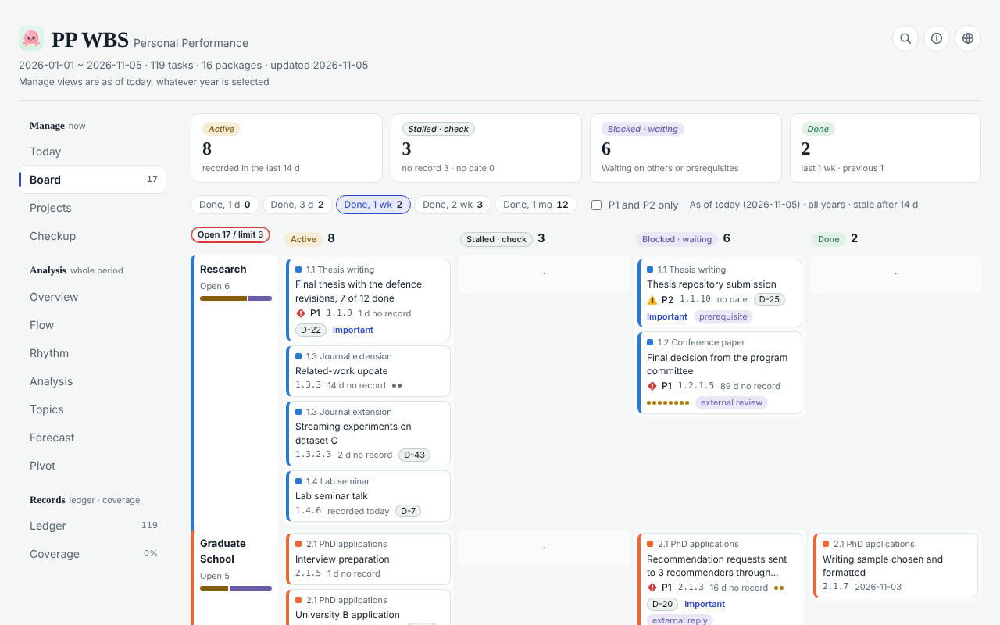

**English** | [한국어](README.ko.md) | [简体中文](README.zh-CN.md)

# personal-wbs

One ledger of everything you do, across years, kept up to date by Claude agents, with a self-contained HTML dashboard.



## What it is

- **A personal work-breakdown structure (WBS) ledger.** `wbs.csv` holds every deliverable, decision and event of your work and life admin, all years in one file, in a code tree: area → package → task → step (`1.2.3.4`).
- **Kept by agents.** Five Agent Skills let Claude (Claude Code, Cowork, claude.ai) or any agent that reads `SKILL.md` build the ledger from your sources, log new work silently after each task, sweep for anything that was missed, show today's one-minute view, and set up the daily and weekly background runs.
- **A dashboard that is one HTML file.** No server and no account: it reads the CSV files next to it and computes everything in the browser.
  - **Board**: today's open work, what is blocked, overdue or due soon, your focus packages.
  - **Health check**: ten indicators read against reference ranges, like a lab panel, partly against your own past year, with a verdict, prescriptions and a re-check date.
  - **Project-management techniques**: Little's law (WIP = throughput × cycle time), service level expectation (SLE) and ageing work in progress, Monte Carlo forecasts of when open work will be done, XmR process-behaviour charts of weekly throughput, topic clustering of task text, and work phases over time.
  - **Status check mode**: walks through open tasks one by one with Done / In progress / Blocked / Backlog / Skip buttons.
  - Ledger and coverage views to read the raw rows and see how completely each source has been swept.
- **Agent files.** `summary.json` and `llms.txt` let any agent answer "what is blocked?", "what did I finish this week?" or "how am I doing?" without parsing the CSV.

- **Why it works**: the research behind each design choice, with verified references: [docs/research.md](docs/research.md).

## Why: raw data first

Planning tools ask you to describe work before you do it, then drift away from reality. This package records what actually happened, with exact dates and evidence, from the places your work already leaves traces: chats, commits, documents, mail, calendars.

- **Rows are raw data, never summaries.** One row is one concrete deliverable, decision or event, dated from its source and pointing to its evidence. A date range is allowed only for one continuous piece of work; its separately dated steps are child rows.
- **Every view is computed.** Rollups, health checks, topics and forecasts are calculated from the rows, so analyses can improve without rewriting history, every number traces back to rows, and every row traces back to its source.
- **Agents do the bookkeeping.** They log after each task, collect daily and review weekly. You confirm; they record.

## How onboarding works

The `wbs-bootstrap` skill builds the ledger in one guided session:

1. **Permissions first.** Connect every source you have (past chats and memory, Google Drive, Gmail, Calendar, Slack, Notion, GitHub, a ChatGPT export) and allow the skills' tools once, so background runs never stall. The completeness of the first import decides the ledger's quality.
2. **Taxonomy sign-off.** The agent skims titles across your history and proposes 4–7 areas, packages per year and a short goal list. Nothing is written until you approve. See the [taxonomy guide](docs/taxonomy.md).
3. **Full historical import.** Every source × month is a window, enumerated by ID, oldest first, with coverage tracked in `coverage.csv`.
4. **Atomization.** Rows that bundle several outcomes or span long periods are re-read and split into dated steps.
5. **Status check.** Imported records lag reality, so the agent asks you, ten tasks at a time, which open tasks are already done, blocked or parked, with likely answers pre-filled from evidence. You can also do this in the dashboard's Status check mode.
6. **Background runs.** A daily collection and a weekly review are scheduled, so you never have to ask for things to be added.

## Quick start

### Claude Code

```
/plugin marketplace add Jisung-Pacific/personal-wbs
/plugin install personal-wbs@personal-wbs
```

Then say "Build my WBS ledger" (or run `/personal-wbs:wbs-bootstrap`). The skills are used automatically afterwards: work gets logged, and "how am I doing?" gets an answer.

### claude.ai

1. Build the skill zips: `python3 scripts/package_skills.py` writes one zip per skill to `dist/` (`wbs-bootstrap`, `wbs-tracker`, `wbs-sweep`, `wbs-today`, `wbs-schedule`). Each holds the skill folder plus the helper scripts, because an uploaded skill sees only its own folder.
2. Upload each zip in **Settings → Capabilities → Skills** (called **Customize → Skills** in newer versions) and turn the skills on. Code execution must be enabled.
3. Ask "Build my WBS ledger".

You can also zip a skill folder by hand (from `skills/`: `zip -r wbs-tracker.zip wbs-tracker/`; the zip must contain the folder itself). Without the scripts, the skills fall back to manual checks.

### Any agent that reads Agent Skills

Point it at `skills/*/SKILL.md`. The scripts are Python 3 with the standard library only and take the ledger folder as their argument. Install steps for Gemini CLI, OpenAI Codex and Grok Build are in [docs/ports.md](docs/ports.md).

### Optional: log sessions automatically (Claude Code)

```
/plugin install personal-wbs-autolog@personal-wbs
```

A separate plugin. When a Claude Code session ends, a hook notes only its ID, time, folder and transcript path on your computer; when you agree, the `wbs-autolog-drain` skill logs the work of those sessions. See [plugins/personal-wbs-autolog](plugins/personal-wbs-autolog/README.md).

### Try the sample

The sample ledger is fully synthetic: a fictional master's student applying for PhD programs who also runs a small study-habit app, over 2025–2026, in English (`sample/en`) and Korean (`sample/ko`). Its reference date is 2026-11-06.

```
python3 scripts/sample_data.py                                # writes sample/en and sample/ko
python3 scripts/validate.py sample                            # checks both
python3 scripts/make_agent_files.py sample --as-of 2026-11-06 # summary.json and llms.txt
python3 scripts/reconcile.py list sample/en --as-of 2026-11-06
```

The dashboard page is not in the repository yet: at about 0.6 MB it is over the plugin directory's 256 KiB limit per file, so it will ship as a release download (see [templates/dashboard](templates/dashboard/README.md)). It reads the CSV files of a folder such as `sample/en`.

## The skills

| Skill | Use it when | What it does |
|---|---|---|
| `wbs-bootstrap` | you start a ledger, or rebuild one | permissions checklist, inventory of sources, taxonomy sign-off, exhaustive historical import, atomization, events, status check with you, dashboard, scheduled daily and weekly runs |
| `wbs-tracker` | after any task that produced a result; when you ask about your work | logs each result silently as an atomic, dated row with evidence; answers "what is open, blocked, overdue, finished"; runs the weekly health check |
| `wbs-sweep` | daily collection, finding unlogged work, backfilling a year | resumable source × month sweep with coverage states, snowballing, the range-row atomization pass and re-checks of undated rows |
| `wbs-today` | you ask what to do today, or a daily summary runs | today's top three tasks, what is late or blocked, at most three decisions; changes the ledger only for the decisions you answer |
| `wbs-schedule` | you want the ledger to update itself | ready prompts for the daily collection, the weekly review and a daily summary, with the steps in Cowork, the Claude app or Claude Code; creates a schedule only when you ask |

| Script | Purpose |
|---|---|
| `validate.py <folder>` | checks wbs.csv (22 columns, keys, parents, dates, values, prerequisites, privacy lint) and the companion files; `--atomize` lists rows to split |
| `make_agent_files.py <folder>` | writes `summary.json` and `llms.txt`, including the health check |
| `reconcile.py list/apply <folder>` | the status check: lists open tasks in batches, writes your answers back |
| `sample_data.py` | regenerates the synthetic sample |
| `package_skills.py` | zips each skill with the scripts for upload |

### Tests

`evals/` holds behaviour tests for `claude plugin eval`: each skill fires on the right request and stays out of unrelated ones, and three outcomes on three days become three dated rows, never one range row. See [evals/README.md](evals/README.md).

## Data model

| File | Content |
|---|---|
| `wbs.csv` | the ledger: 22 columns, UTF-8 with BOM, all years |
| `plan.csv` | goals, focus packages, health-check dates, settings (`kind,year,target,note,decided,recheck`) |
| `events.csv` | append-only log of creations, status changes, corrections and moves (`estimated` = Y when rebuilt later) |
| `coverage.csv` | sweep state per year × month × source window: `not_started`, `partial`, `complete`, `unavailable` |
| `sweep_state.json` | item IDs already judged (private) |
| `summary.json`, `llms.txt` | generated for agents |

The 22 columns of `wbs.csv` (English headers; Korean headers in brackets):

`year` (연도) · `code` (WBS) · `level` (레벨) · `area` (대분류) · `package` (중분류) · `parent` (상위 작업) · `task` (작업·산출물) · `start` (시작일) · `end` (종료일) · `date_text` (일자(원문)) · `start_month` (시작월) · `status` (상태) · `key_result` (핵심성과) · `source` (출처) · `due` (마감일) · `importance` (중요도) · `size` (크기) · `depends_on` (선행) · `blocker` (막힘 사유) · `last_progress` (최근 진행일) · `goal` (목표) · `evidence` (근거)

- Row key is (year, code); each year has its own tree; codes are permanent.
- Status: `done`, `in_progress`, `waiting` (on someone else), `backlog` (parked on purpose).
- Dates are exact days from the sources; unknown dates stay blank and are flagged for the sweep, never guessed.
- `blocker` reads `<category>: <organisation or role>`, `depends_on` lists prerequisite codes, `evidence` lists pointers such as `claude:<chat id8>`, `gh:<owner/repo>#<PR>`, `drive:<file title>`, `cal:<date>`.
- Language: English headers are the default; Korean headers and values work everywhere. Chinese-speaking users keep English headers and can write task text in Chinese.

## Privacy model

### What the plugin reads, writes and sends

| | |
|---|---|
| **Reads** | Your past Claude chats (chat search), Claude Code session transcripts on your machine, exports you upload (ChatGPT, Claude), and the apps you have connected: Google Drive, Gmail, Google Calendar, Slack, Notion, GitHub. Read-only. |
| **Writes** | The ledger files (`wbs.csv` and its companions) to the place you choose: a claude.ai artifact, a local folder, or your own private Git repository. |
| **Sends** | Nothing to the author or to any other service: no server, no telemetry, no analytics. The one write that leaves Claude is the commit to your own Git repository, made only if you chose that location and asked for it. |
| **Personal data** | Read through your connectors to find your work, not stored. Rows describe the work and name organisations and roles, never other people's names, e-mail addresses or phone numbers (`validate.py` warns if one slips in). |
| **Retention** | Nothing is kept outside your own files. |
| **Optional autolog** | The separate `personal-wbs-autolog` plugin writes, on your computer only, the ID, time, folder and transcript path of each finished Claude Code session to its own data folder. Transcripts are read only when you approve logging them. |

The full policy is in [PRIVACY.md](PRIVACY.md); the data flow is drawn in [docs/data-flow.md](docs/data-flow.md), and security reporting is in [SECURITY.md](SECURITY.md).


- **Your data stays where you put it**: a local folder, a private repository or a private artifact. There is no server; the dashboard computes in your browser.
- **Sources are read-only.** The skills never send, edit, share or delete anything in a connected app.
- **Pointers, not copies.** Rows hold short descriptions and evidence IDs, not message contents.
- **Privacy defaults you can edit**: skip health, relationships, financial account numbers and other people's personal handles (organisations and roles are named instead); leave out personal income and similar amounts; keep business costs, public prices and technical metrics.
- `sweep_state.json` lists the IDs of everything reviewed: never publish it.
- `validate.py` warns about e-mail addresses, @handles, phone numbers and long account-like numbers in the ledger.
- The sample data is synthetic; no real person, organisation or record is described.

## Repository layout

```
personal-wbs/
├── .claude-plugin/          marketplace.json, plugin.json, icon.png (Claude plugin marketplace)
├── skills/
│   ├── wbs-bootstrap/SKILL.md
│   ├── wbs-tracker/SKILL.md
│   ├── wbs-sweep/SKILL.md
│   ├── wbs-today/SKILL.md
│   └── wbs-schedule/SKILL.md
├── scripts/                 validate.py, make_agent_files.py, reconcile.py, sample_data.py,
│                            package_skills.py, wbs_schema.py (Python 3, standard library)
├── evals/                   behaviour tests for claude plugin eval
├── plugins/personal-wbs-autolog/   optional Claude Code plugin: session-end hook, collector agent, drain skill
├── sample/en, sample/ko     synthetic sample ledger and generated agent files
├── templates/dashboard/     notes on the dashboard page
├── docs/                    taxonomy guide (en, ko, zh-CN), research, data flow, other agents
├── gemini-extension.json    Gemini CLI extension manifest
├── README.md, README.ko.md, README.zh-CN.md, PRIVACY.md, SECURITY.md
└── LICENSE
```

## Roadmap

- Dashboard: ship the page in files under 256 KiB so it can live inside the plugin; it already switches between English, Korean and Simplified Chinese at runtime.
- Ledger headers in more languages (today: English and Korean).
- Recipes for more sources (issue trackers, other mail and calendar providers, note apps).
- Automated tests and CI for the scripts, and a machine-readable schema file.

## Contributing

Issues and pull requests are welcome.

- Keep the scripts on Python 3.8+ with the standard library only, and the skills self-contained and in English.
- Update user-facing docs in all three languages together (English, Korean, Simplified Chinese).
- Never add real personal data. Sample data must stay synthetic; change `scripts/sample_data.py` and regenerate.
- Before opening a pull request, run:

```
python3 scripts/sample_data.py
python3 scripts/validate.py sample --strict
python3 scripts/make_agent_files.py sample --as-of 2026-11-06
claude plugin validate --strict .
claude plugin validate --strict plugins/personal-wbs-autolog
```

Behaviour tests call the model and count against your usage: `claude plugin eval . --scaffold --allow-tools Write Edit "Bash(python3 *)"`.

## License

MIT. Copyright (c) 2026 Jisung Park. Author: Jisung Park.
