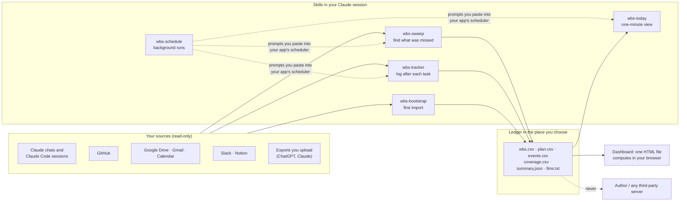

# Data flow

Everything happens inside your own Claude session and your own files. There is no server; nothing goes to the author.

| Step | What moves | Where it goes |
|---|---|---|
| Read | Titles, dates and IDs of your chats, commits, files, mail, events and pages, through the connectors you enabled | Into the Claude session only |
| Write | Short rows describing the work, with evidence pointers (chat ID, PR number, file title) | `wbs.csv` and its companions, in a claude.ai artifact, a local folder or your private Git repository |
| View | The CSV files | The dashboard page, computed in your browser |
| Send | Nothing | No telemetry, no analytics, no author server |

The optional autolog plugin adds one local step: when a Claude Code session ends, a hook appends the session's ID, time, working folder and transcript path to `queue.jsonl` in the plugin's data folder on your computer. The transcript is read later, in a session, only when you ask the `wbs-autolog-drain` skill to log the queue.

The privacy policy is in [PRIVACY.md](../PRIVACY.md); security reporting in [SECURITY.md](../SECURITY.md).
